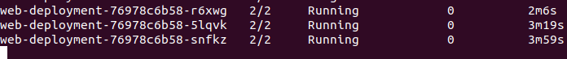
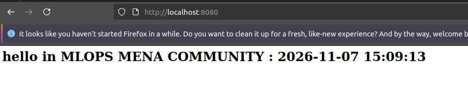
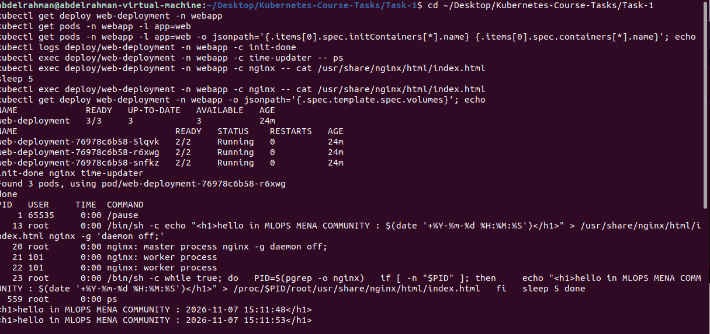

# Task 1: Multi-container Pods

An nginx hello page on a 3-node Minikube cluster. Each Pod has an init container, nginx and a sidecar. No volumes.

## What I did

- Installed Docker, kubectl and Minikube on an Ubuntu VM.
- Started a 3-node cluster with Calico: `minikube start --nodes 3 --driver=docker --cni=calico --cpus 2 --memory 1800`
- Created the `webapp` namespace.
- Deployed `web-deployment` with 3 replicas. Each Pod runs `init-done`, `nginx` and `time-updater`, with `shareProcessNamespace: true`.
- Checked that all 3 Pods reached `2/2 Running` and the page time changed every 5 seconds.
- Ran the verification checks: init log, `ps`, no volumes.
- Changed the init command to `exit 1` and applied the file again.
- Restored the init command and confirmed `READY 3/3`.

## Failure result

- The new Pod showed `Init:Error`, then `Init:CrashLoopBackOff`, with READY `0/2`.
- nginx and time-updater did not start.
- The 3 old Pods kept running, so the page stayed up.

## Files

- `namespace.yaml`
- `deployment.yaml`

## Screenshots

