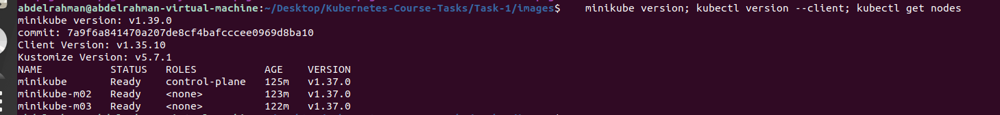
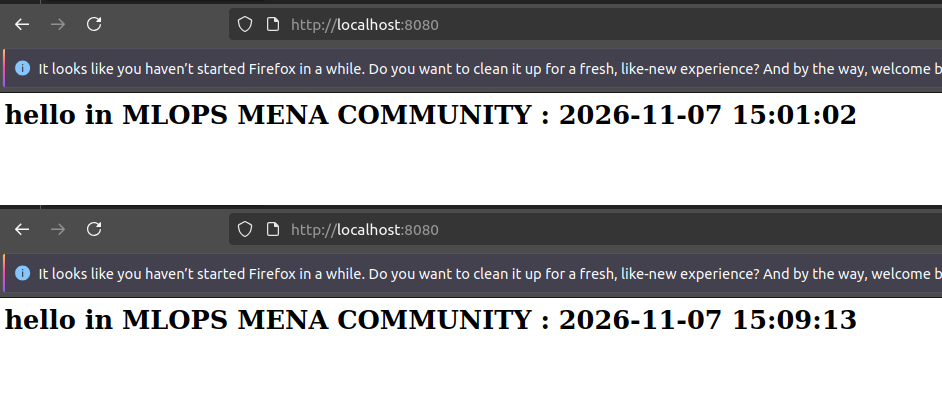
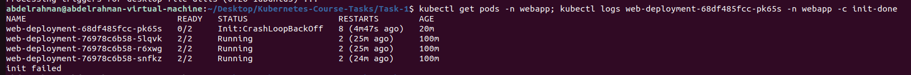
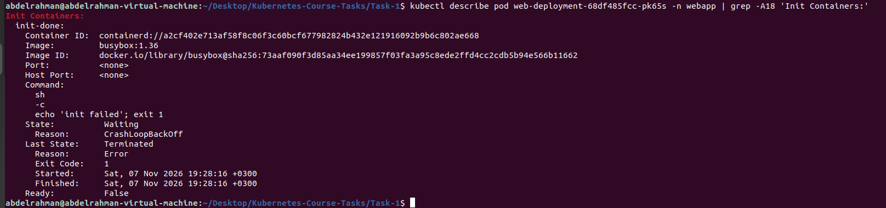
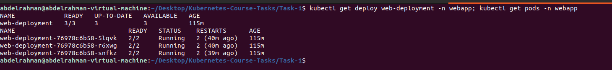

# Task 1: Multi-container Pods

An nginx hello page on a 3-node Minikube cluster. Each Pod has an init container, nginx and a sidecar. No volumes.

## What I did

- Installed Docker, kubectl and Minikube on an Ubuntu VM.
- Started a 3-node cluster with Calico: `minikube start --nodes 3 --driver=docker --cni=calico --cpus 2 --memory 1800`
- Created the `webapp` namespace.
- Deployed `web-deployment` with 3 replicas. Each Pod runs `init-done`, `nginx` and `time-updater`, with `shareProcessNamespace: true`.
- Checked that all 3 Pods reached `2/2 Running` and the page time changed every 5 seconds.
- Ran the verification checks: init log, `ps`, no volumes.
- Changed the init command to `exit 1` and applied the file again.
- Restored the init command and confirmed `READY 3/3`. The Deployment reused the old ReplicaSet, so the original Pods kept running.

## Answers for the failure test

- **Status of the new Pod:** `Init:Error`, then `Init:CrashLoopBackOff`, READY `0/2`.
- **Do nginx and time-updater start?** No. Init containers must exit with code 0 first.
- **Is the page still reachable?** Yes. The Deployment keeps the 3 old Pods until the new Pod is Ready. The new Pod never becomes Ready.

## Files

- `namespace.yaml`
- `deployment.yaml`

## Screenshots

1. Tools and 3 Ready nodes

2. Page time changing

3. Verification checks

4. Failed init: Pod status and log

5. Init container, Exit Code 1

6. After the fix: 3/3 ready

